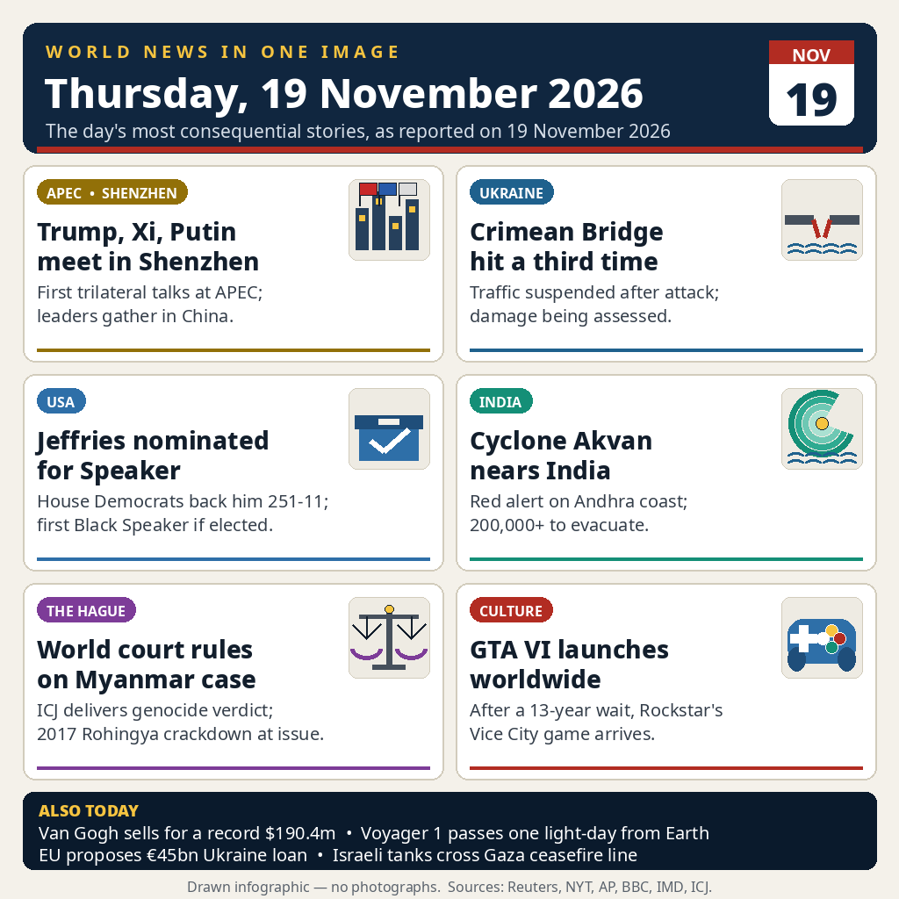

# news-image-20261119-kira

[](https://make.fun/bounty/news-image-20261119?utm_source=github&utm_medium=readme&utm_campaign=news-image-20261119)
[](https://make.fun/bounty/news-image-20261119/leaderboard?utm_source=github&utm_medium=readme&utm_campaign=news-image-20261119)
[](https://make.fun/bounty/news-image-20261119?utm_source=github&utm_medium=readme&utm_campaign=news-image-20261119)

One image summing up the world news of **Thursday, 19 November 2026**:
a drawn newspaper-style poster naming the day, with six major stories
from six regions and fields, plus an "also today" strip.



## The stories

1. **APEC, Shenzhen** — Trump, Xi and Putin gather for their first
   trilateral talks at the APEC summit in China.
2. **Ukraine** — The Crimean Bridge is attacked a third time this week;
   traffic is suspended while damage is assessed.
3. **USA** — House Democrats nominate Hakeem Jeffries for Speaker,
   251-11; he would be the first Black Speaker if elected on 3 January.
4. **India** — Severe Cyclone Akvan nears the Andhra Pradesh coast;
   red alert, with more than 200,000 people to be evacuated.
5. **The Hague** — The ICJ delivers its verdict in The Gambia v. Myanmar,
   the Rohingya genocide case; the 2017 crackdown is at issue.
6. **Culture** — After a 13-year wait, Grand Theft Auto VI launches
   worldwide.

Also today: a Van Gogh sells for a record $190.4m; Voyager 1 passes one
light-day from Earth; the EU proposes a €45bn Ukraine loan; Israeli tanks
cross the Gaza ceasefire line in a rare incursion. Sources and dating
notes are in [RESEARCH.md](RESEARCH.md).

## How it works

- `entry.png` — the finished poster (1024 x 1024, drawn programmatically).
- `render_poster.py` — the script that draws the poster with PIL and the
  Noto Sans fonts. Run it with `python3 render_poster.py` to regenerate
  `entry.png`. No photographs and no AI image generation were used.
- `main.py` — the competition entrypoint (Python standard library only).
  It copies `entry.png` to `/output/entry.png`, or to
  `$MAKEFUN_OUTPUT_DIR/entry.png` for a local run. It writes identical
  bytes on every run.

Local check:

```sh
mkdir -p out && MAKEFUN_OUTPUT_DIR=out python3 main.py
```

## License

MIT — see [LICENSE](LICENSE).

---

Built for the make.fun bounty "Sum up 19 November's world news in one image". Referral code: 3a433hx8
